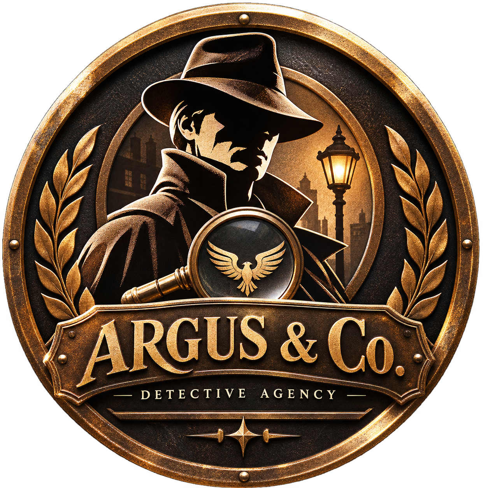
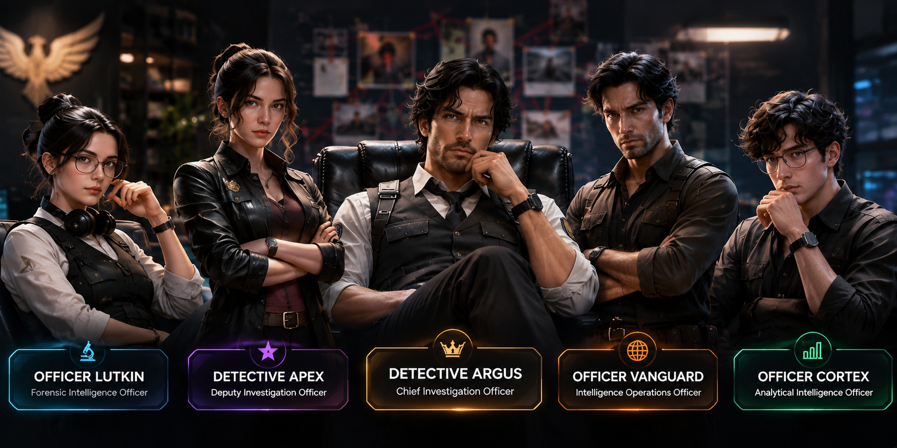
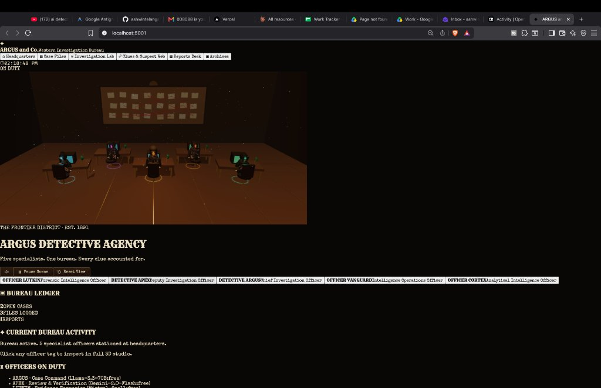
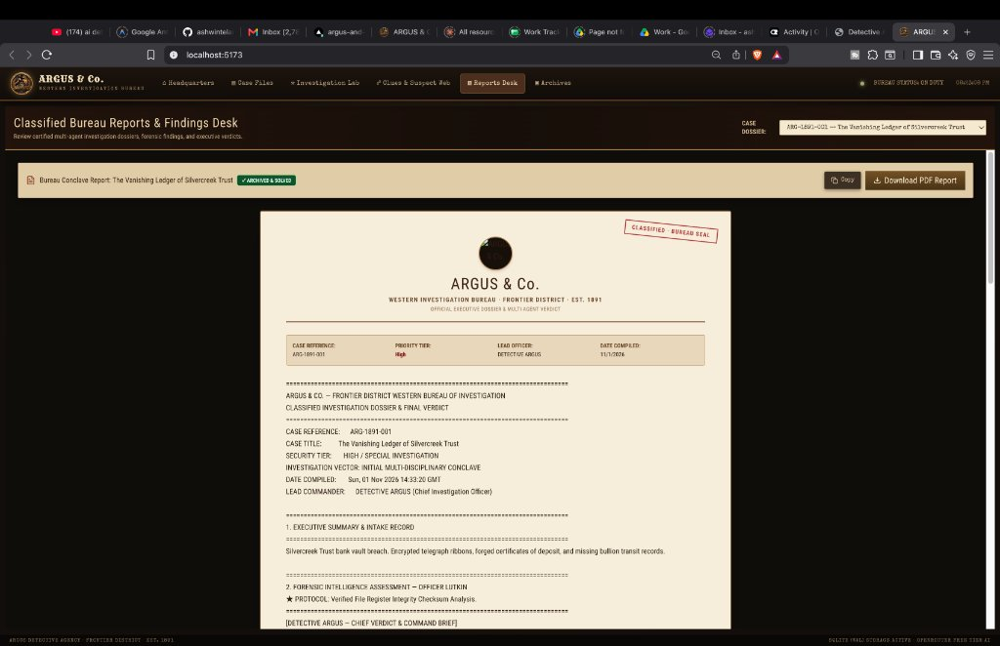

<p align="center">
  
</p>

<h1 align="center">ARGUS & Co.</h1>
<h3 align="center">Western Investigation Bureau · Frontier District · Est. 1891</h3>

<p align="center">
  <strong>An Autonomous Multi-Agent AI Investigation Agency with Ultra-Realistic 3D Headquarters, Interactive Red Yarn Evidence Board, Voice-Acted Detective Presentations, and Certified Forensic Dossiers.</strong>
</p>

<p align="center">
  
  
  
  
  
  
</p>

---

## ✦ Overview

**ARGUS & Co.** is a full-stack, narrative-driven AI investigation agency platform set in a stylized Western Frontier District. The agency operates via a synchronized team of **five specialized autonomous AI detective agents**. 

Users submit complex criminal dossiers with physical and digital evidence (documents, surveillance logs, audio spectrograms, wire intercepts, binary data). The bureau's officers autonomously convene in a multi-stage **Bureau Conclave**, cross-examine leads, calculate probability matrices, construct an interactive **Red Yarn Clues & Suspect Web**, deliver voice-acted **Cinematic Case Presentations**, and compile certified **Executive Verdict Reports** ready for print-to-PDF export.

---

## ♜ The Bureau Officers & Character Roster

<p align="center">
  
</p>

The Bureau relies on five distinct investigative disciplines. Each detective is modeled with specialized procedural 3D PBR geometry, tailored attire, and distinct investigative doctrines:

| Officer | Designation | Division | Core Specialty |
|---|---|---|---|
| **Detective Argus** | Chief Investigation Officer | Executive Command | Case strategy synthesis, motive analysis, audits overlooked clues, and delivers the binding final verdict unmasking the culprit. |
| **Detective Apex** | Deputy Investigation Officer | Adversarial Red-Team | Skeptical cross-examination, confirmation bias defense, alibi stress-testing, and challenging baseline assumptions. |
| **Officer Lutkin** | Forensic Intelligence Officer | Digital & Physical Forensics | Cryptographic SHA-256 validation, audio spectrogram analysis, file register integrity, and chemical ink forgery chromatography. |
| **Officer Vanguard** | Intelligence Operations Officer | OSINT & Field Recon | Public registries, transit manifests, wiretap intercepts, boundary coordinates, and syndicate entity reconnaissance. |
| **Officer Cortex** | Analytical Intelligence Officer | Analytical Link Matrix | Probability matrices, temporal anomaly detection, mathematical Fourier analysis, and relational suspect graph clustering. |

---

## 🏛️ Comprehensive Application Features

### 1. 3D Bureau Headquarters Scene

<p align="center">
  
</p>

* **Fully Enclosed 360° Detective Office**: Built in Three.js with aged oak floorboards, darkwood wainscoting, heavy timber ceiling cross-beams, transom windows, double bureau entrance doors, and suspended atmospheric dust particles.
* **Bounded Camera Space**: OrbitControls and camera boundaries are strictly constrained within the interior room boundaries, allowing users to rotate 360 degrees smoothly in all directions without clipping through walls or ceiling.
* **Autonomous Agent Free Roaming & Obstacle Avoidance**: Detectives patrol the office freely, inspect the case board, pace the aisles, and converse. Advanced path routing and physical collision repulsion guarantee agents navigate smoothly through corridors and **never pass through tables or desks**.
* **Station at Desks & Dynamic Chair Adjustment**:
  * With one click, order all agents to station at their assigned desks (or free them to roam).
  * As a detective approaches their workstation, their **swivel chair smoothly slides back and adjusts** to welcome them.
  * The detective sits down in a seated posture with arms resting forward on the keyboard and telegraph sender.
* **Live Working CRT Computer Terminals**:
  * Every desk—including the **Central Command Table** for Chief Argus—is equipped with a functioning CRT monitor system.
  * Real-time animated canvas textures display cathode ray scanlines, glowing phosphor text, fluctuating telemetry streams, and dynamic oscilloscope waveforms tailored to each officer's discipline.
* **Atmospheric Lighting Switch**: Toggle between bright daylight frontier lighting and atmospheric noir night mode with flickering desk candles and warm lantern glow.
* **Interactive Central Corkboard**: Mounted medallion seal plaque, live case docket banner, evidence cards with live SHA-256 hashes, and red yarn threads. Clicking any pinned card zooms the camera in to inspect chain of custody.

---

### 2. Case Files & Evidence Vault

* **Dossier Intake Desk**: Open new investigation files with title, priority tier (Routine, Urgent, High, Critical), category, lead officer, and operational intake notes.
* **Multi-Format Evidence Depository**: Drop-zone supporting images (`JPG`, `PNG`), audio recordings, text documents (`PDF`, `DOC`, `TXT`), spreadsheets (`CSV`, `XLS`), and binary data (`DAT`, `LOG`).
* **Cryptographic Chain of Custody**: Automatic generation of SHA-256 checksums upon file upload ensures tamper-proof forensic auditability.
* **Active Bureau Dossier Ledger**:
  * Real-time ledger displaying all active cases.
  * **Edit Case Dossier**: In-place modal to modify case reference, title, priority, category, status, and lead investigator.
  * **Work On/Off Toggle**: Activates a case for immediate analysis in the Investigation Lab.
  * **Close & Archive**: Direct user-controlled action to mark solved cases and transfer them safely to the historical Archives.

---

### 3. Investigation Lab & Autonomous Bureau Conclave

* **Autonomous 5-Officer Conclave**: Initiates a multi-agent sequential investigation streamed live via Server-Sent Events (SSE) with vintage typewriter sound effects:
  1. *Officer Lutkin* inspects cryptographic hashes and forensic validity.
  2. *Officer Vanguard* cross-checks wire intercepts and OSINT shipping manifests.
  3. *Officer Cortex* calculates correlation probabilities and isolates temporal anomalies.
  4. *Detective Apex* performs adversarial red-team review, stress-testing alternative suspects.
  5. *Detective Argus* synthesizes all findings, audits overlooked clues, and renders the official verdict identifying the culprit.
* **Conditional Forensic Deep Web Search**: If intake documents lack required telemetry, Lutkin and Vanguard execute targeted OSINT lookups to fill evidentiary gaps.
* **Zero Model Leaks**: Displays pure bureau narrative intelligence without exposing internal AI model names.
* **1-on-1 Character Biometric Studio**: Inspect any officer in 3D with Ultra-Realistic, 3D Wireframe, and Thermal Vision modes, and interrogate them directly via live chat.

---

### 4. Clues & Suspect Web (Investigation Board)

* **Autonomous Red Yarn Flowchart**: Pinned suspect cards, verified evidence artifacts, crime scenes, and deduction nodes connected by dynamic red yarn strings.
* **Exclusively Curated by Bureau AI**: The board is populated and updated autonomously by the 5 detective officers during their conclave deliberations, guaranteeing human-like forensic accuracy.
* **Cinematic "Present the Case" Feature**:
  * Click the **Present the Case** button to launch a sequential comic-book presentation modal.
  * Each officer steps forward one by one (*Cortex → Vanguard → Lutkin → Apex → Chief Argus*).
  * **Spoken Aloud**: Powered by Kokoro Voice Engine with unique voices, natural sentence cadence, and emotional delivery.
  * Navigation controls allow seamless Next, Previous, and Voice Repeat operations.
  * Concludes with Chief Argus summarizing the evidentiary threads and unmasking the perpetrator.

---

### 5. Classified Reports Desk & Findings

<p align="center">
  
</p>

* **Official Bureau Letterhead**: Features the authentic golden ARGUS & Co. frontier seal (`logo.png`) framed with a vintage gold border on authentic parchment paper.
* **Publication-Grade Formatting**: Rendered using `BureauContentRenderer` to strip raw markdown asterisks, sanitize LaTeX symbols into plain English/Unicode, and format structured forensic tables.
* **WYSIWYG Fill-to-Page PDF Export**: Click **Download PDF Report** to generate a clean, borderless, multi-page print document with correctly aligned SHA-256 certification and Chief Argus's signature block.
* **Post-Conclave Actions**:
  1. **End Case & Seal in Archives**: Finalizes the case, seals the dossier, and relocates it to the Archives tab.
  2. **Re-Analyse Case (Alternative Approach)**: Re-convenes the 5 officers under a contrarian investigative vector, challenging initial assumptions to uncover deeper syndicate conspiracies.

---

### 6. Bureau Archives

* Historical repository of all concluded, solved, and archived investigations.
* Search and filter archived cases by reference number, title, or lead officer.
* **Reopen Case Dossier**: Seamlessly returns an archived case to active duty in the Ledger for further investigation.

---

## 🛠️ Technology Stack

| Layer | Technology | Purpose |
|---|---|---|
| **Frontend** | React 18, Vite 5, Tailwind CSS | High-performance SPA with vintage Western Bureau aesthetics and typography (`Rye`, `Special Elite`). |
| **3D Rendering** | Three.js (r160), OrbitControls | 360° enclosed headquarters, dynamic PBR lighting, working CRT canvas screens, procedural detective avatars, and smooth animations. |
| **Voice Synthesis** | Web Audio API, Kokoro Voice Engine | Character-tailored speech synthesis with emotional cadence and natural pauses. |
| **Sound Effects** | Procedural Web Audio API Synthesizer | Typewriter key clicks, telegraph beeps, camera shutters, biometric hums, and conclave chimes. |
| **Backend** | Node.js (v22+), Express | REST API, SSE streaming, multi-agent orchestration, and secure file upload handling. |
| **Evidence Vault** | Native Embedded Relational Database | Secure storage for cases, evidence custody, clues, deliberations, audit trails, and certified reports. |
| **Multi-Agent AI** | OpenRouter Free Tier / Gemini API | Multi-disciplinary reasoning, OSINT search, and forensic deduction with automated fallback. |

---

## 🚀 Getting Started

### Prerequisites

* **Node.js**: `v22.0.0` or higher (`node -v`)
* **npm**: `v10.0.0` or higher

### Installation

1. **Clone the repository:**
   ```bash
   git clone https://github.com/ashwintelangstark/ARGUS-and-Co..git
   cd ARGUS-and-Co.
   ```

2. **Install all dependencies:**
   ```bash
   npm run install:all
   ```

3. **Configure Environment Variables:**
   Copy `.env.example` to `.env`:
   ```bash
   cp .env.example .env
   ```
   Add your OpenRouter or Gemini API keys in `.env` (optional free fallback is built-in).

4. **Launch Development Servers:**
   ```bash
   npm run dev
   ```
   * Frontend: `http://localhost:5173`
   * Backend API: `http://localhost:3000`

5. **Production Build:**
   ```bash
   npm run build
   ```

---

## 🔒 Security & Privacy

* **Strict Git Exclusions**: All `.env*` files are strictly git-ignored to protect secret keys.
* **Serverless Compatibility**: On Vercel deployments, the database automatically mounts to `/tmp` with safe delete journal mode.
* **Cryptographic Integrity**: All ingested evidence files are fingerprinted with SHA-256 checksums to preserve chain-of-custody authenticity.

---

## 📜 License

Created for **ARGUS and Co. Western Investigation Bureau**. All rights reserved. Est. 1891.
